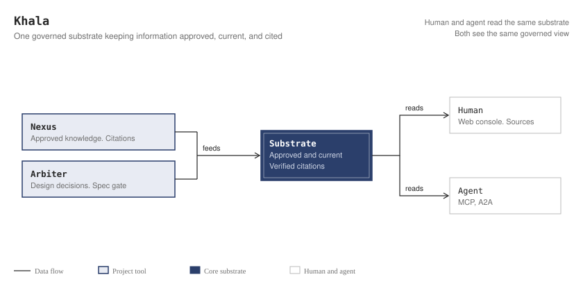

<p align="center">
  
</p>

<h1 align="center">Khala</h1>

<p align="center">
  <strong>An alliance of tools that calibrates the AI era.</strong>
</p>

<p align="center">
  <em>AI builds it. You understand it.</em>
</p>

<p align="center">
  <a href="README.md"><strong>한국어 정본 문서 (Korean)</strong></a>
</p>

---

AI coding agents raised development speed, and engineering organizations now face three problems. Khala answers these with deterministic grounding and pre-approval governance gates, not advice. Khala is not a tool you run; it is the link the tools share. The ecosystem is **Khala**; one of its components is **Nexus**.

- **confident hallucination** — models write false answers and fragile code with high confidence from expired documents or wrong assumptions. Defended by grounding answers in verifiable sources and by mechanical checks: every citation is verified against the retrieved evidence, answer numbers must appear in that evidence, and answers built on stale sources are flagged.
- **rubber-stamping** — engineers approve the large volume of agent code after only seeing tests pass, without understanding it. Defended by making accountable review a gate before code is written (Arbiter).
- **cognitive debt explosion** — the system grows fast while fewer people on the team can explain how it works and why decisions were made. No tool measures it today (ADR-0011).

## One substrate, four kinds of information

Khala exists so that everyone who builds and runs the service — humans *and* agents —
thinks from the **same information**. Documents alone don't cover that. Four kinds of
information drift apart in an AI-era org, and each one is a Khala surface:

<p align="center">
  <picture>
    <source media="(prefers-color-scheme: dark)" srcset="assets/same-information.en.dark.svg" />
    
  </picture>
</p>

| Information | How it stays *the same* for everyone | Tool |
|---|---|---|
| **What the org knows** — docs, specs, know-how | Single governed substrate, dual access interfaces: humans (web) and agents (MCP/A2A) read the same governed corpus — same approvals, same current version, same citations. | [Nexus](./nexus) |
| **Why it was built** — design decisions | Architecture decision recorder: choices coding agents make by the hundred are recorded at zero marginal cost, and approval stays a named human's accountable act. | [Arbiter](https://github.com/khala-labs/arbiter) |
| **Runtime operational state** (traces, metrics) | Nexus aggregates OpenTelemetry traces into observed call edges (`CALLS_OBSERVED`) and reports where design documents and observed calls differ (`doc_only`, `observed_only`, `conflict`). The OTel pipeline is opt-in. | [Nexus](./nexus) |
| **Who still understands the system** (cognitive debt) | No tool measures it. The tool that was built for it (Adept) was archived; ADR-0011 keeps this open. | None (open, ADR-0011) |

## The three debts of the AI era

As AI becomes the producer, three debts accumulate:

- **Technical debt** — artifacts pile up faster than they are maintained.
- **Intent debt** — *why* a decision was made is lost → **Arbiter**.
- **Cognitive debt** — *nobody fully understands the system*.

The reframe is recorded in [ADR-0002](records/adr/ADR-0002-reframe-system-command-debt.md).

## The tools

The tools are grouped by status. The dates indicate the last functional change in this repository.

### Active

| Tool | Role | Status (date) | Directory link |
| --- | --- | --- | --- |
| **Nexus** | Hybrid retrieval over your docs and OTel telemetry — every answer carries citations that are verified in code.<br>- **Archon** (module inside Nexus, not a separate tool): Authority window over domain invariants — reads values from code constants at query time. | Code under development, not deployed (as of 2026-11-11; last data is the 2026-11-10 DB dump); last code change 2026-11-10 | [`./nexus`](./nexus)<br>(Archon: [`./nexus/nexus/claims`](./nexus/nexus/claims)) |

### Instrument in use

| Tool | Role | Status (date) | Directory link |
| --- | --- | --- | --- |
| **Arbiter** | ADR/SDD governance MCP — intercepts Write/Edit/MultiEdit when the PreToolUse hook is registered (Bash shell execution not gated); publishes approved specs to Nexus. | Still used as the approval gate for ADRs and SPECs in this repository; last code change 2026-09-05 | [khala-labs/arbiter](https://github.com/khala-labs/arbiter) |

The rest of the repository is [`./docs`](./docs), an Astro Starlight ecosystem documentation site rather than a tool.

## Nexus answer path

This diagram shows the processing of a single POST /search/answer request in Nexus. Code decides what is evidence and what is verified; the LLM only narrates.

<p align="center">
  <picture>
    <source media="(prefers-color-scheme: dark)" srcset="assets/nexus-answer-path.en.dark.svg" />
    
  </picture>
</p>

## Quickstart (Nexus Local Stack)

Prerequisites: Docker and Docker Compose ([go-task](https://taskfile.dev) recommended, or execute docker compose commands directly).

```bash
# (Optional) Anthropic API key for LLM answer synthesis (hybrid retrieval works without it)
export ANTHROPIC_API_KEY=sk-ant-...

task up        # Or: cd nexus && docker compose up -d
task models    # Pull embedding model (docker compose exec nexus-ollama ollama pull nomic-embed-text)
```

> **Keyless dev mode:** Answer generation can be tested locally without a paid API key. Set `NEXUS_DEV_LLM_PROVIDER=claude-code` in `nexus/.env` and run `task llm-bridge` so answers for the local development principal (`local-dev`) go through the host's Claude Code session, leaving `NEXUS_LLM_PROVIDER` at its default `anthropic`. Startup is refused if `NEXUS_LLM_PROVIDER` is set to `claude-code` while any principal other than the owner exists; the bridge also needs `NEXUS_LLM_BRIDGE_TOKEN`, and the full setup is in `nexus/.env.example`.

Open **http://localhost:8000** in your browser to query documentation with cited evidence.

- **Ingest docs:** Use the Web UI upload feature or CLI: `docker compose exec nexus-app nexus ingest ./docs`
- **Update & migrations:** Run `task update` after `git pull` to apply database schema migrations ([nexus/migrations](nexus/migrations/README.md)).
- **Stop services:** `task down` (or `docker compose down`)

## How this repository is kept honest

A system whose promise is calibration must hold itself to the same standard. The guards below are enforced on every push and pull request:

| Guard | When enforced | What it refuses | Why it exists |
|---|---|---|---|
| **Doc-to-code anchors** — [`doc-anchors.yml`](./doc-anchors.yml) | Push · PR | A document whose anchored source paths no longer exist | Prevents documentation drift deterministically by joining docs with code symbols. |
| **Disposable-database marker** | Push · PR | A test run against a database that has not declared itself scratch | Prevents catastrophic data loss in development/production databases. |
| **Fingerprint scanner** | Push (tracked files)<br/>PR (messages, title, body) | Identifying details (partner org names, real emails, SSO tenant hosts, Notion page IDs) | Prevents identifying information leaks across files and PR metadata. |
| **Declared index generations** | Push · PR | Ingestion whose resolved embedding generation differs from the corpus's declared one | Prevents silent index corruption across mismatched embedding models. |
| **Pre-registered verdict rules** | Push · PR | An evaluation harness edited after seeing the score it produced | Enforces objective evaluation rules before benchmark execution. |
| **Declared evaluation corpus** | Push · PR | A label run where nobody said which corpus to ask, or where no label can reach the one being asked | Prevents benchmark evaluation against invalid tenants or corpora. |

Across the repository, 3,200 test functions are declared and 10 CI jobs run in CI, including real Postgres integration with schema migrations. Among governance artifacts (12 ADRs, 56 SPECs), 65 approved or accepted artifacts are stamped and cryptographically verified for integrity in CI via `scripts/ledger_integrity.py`.

- **[→ Engineering log](https://khala-labs.github.io/khala/engineering-log/)** — A dated record of what went wrong, how defects were discovered, and what was remediated.
- Open items are tracked deterministically in [OPEN.md](./OPEN.md).

## Documentation

Full ecosystem reference, philosophy, and per-tool guides are available at:
**https://khala-labs.github.io/khala/** (source in [`./docs`](./docs)).

## Conventions & License

- Contribution flow, naming, versioning, and terminology rules: [CONVENTIONS.md](./CONVENTIONS.md).
- Standard technical glossary: [docs/glossary.md](docs/glossary.md).
- Terminology governance & retired terms: [GLOSSARY.md](./GLOSSARY.md).
- Licensed under the [MIT License](./LICENSE).
