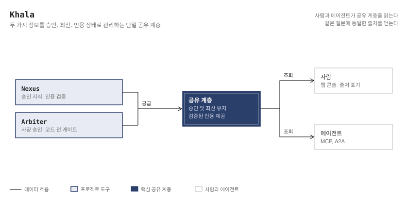

<p align="center">
  
</p>

<h1 align="center">Khala</h1>

<p align="center">
  <strong>AI가 코드를 생성하고, 엔지니어가 아키텍처를 통제한다.</strong><br/>
  <em>AI 코딩 에이전트 시대, 시스템의 신뢰성과 제어권을 보장하는 아키텍처 거버넌스 플랫폼</em>
</p>

<p align="center">
  <a href="README.en.md"><strong>English Documentation (Overview)</strong></a> ·
  <a href="https://khala-labs.github.io/khala/"><strong>공식 문서 사이트</strong></a> ·
  <a href="docs/glossary.md"><strong>표준 용어집</strong></a>
</p>

---

## 개요: 왜 Khala인가?

AI 코딩 에이전트(Claude Code, Cursor 등)의 도입으로 소프트웨어 개발 속도는 비약적으로 향상되었습니다. 그러나 엔지니어링 조직은 이전에 없던 세 가지 치명적인 아키텍처 위기에 직면하게 되었습니다:

1. **확신에 찬 환각 (Hallucination)** — 언어 모델은 만료된 문서나 잘못된 가정을 바탕으로도 높은 확신을 갖고 거짓 답변과 취약한 코드를 작성합니다.
2. **러버스탬핑** — 에이전트가 순식간에 쏟아내는 방대한 양의 코드를 엔지니어가 온전히 이해하지 못한 채, 단순 테스트 통과(초록불)만 확인하고 승인합니다.
3. **인지 부채의 폭발** — 시스템의 규모는 급격히 커지지만, 팀 내부에서 실제 동작 방식과 의사결정 맥락을 온전히 설명할 수 있는 사람은 줄어듭니다.

Khala는 이 문제를 주관적인 조언이나 가이드라인이 아닌, **결정론적인 기계적 검증(Deterministic Grounding)**과 **사전 승인 거버넌스 게이트**를 통해 해결합니다. 인간 엔지니어와 AI 에이전트가 단일 진실 공급원(Single Source of Truth)을 바라보고, 검증된 답변 근거 위에서 코드를 작성하며, 시스템에 대한 이해도를 지속적으로 계측·유지하도록 보장합니다.

---

## 핵심 아키텍처: 단일 공유 계층과 4대 정보 흐름

Khala는 서비스를 개발하고 운영하는 모든 주체(사람과 에이전트)가 동일한 정보 맥락을 공유할 수 있도록, 흩어져 있던 네 가지 핵심 정보를 하나의 관리되는 공유 계층 위에서 결합합니다:

<p align="center">
  <picture>
    <source media="(prefers-color-scheme: dark)" srcset="assets/same-information.dark.svg" />
    
  </picture>
</p>

| 정보 계층 | 단일 진실을 보장하는 메커니즘 | 핵심 도구 |
|---|---|---|
| **조직의 공인 지식**<br/>(문서, 사양, 개발 노하우) | **단일 공유 계층, 이중 접근 인터페이스**: 인간(Web UI)과 에이전트(MCP/A2A)가 동일한 통제 코퍼스를 읽으며, 모든 답변에 검증된 출처 인용이 강제됩니다. | [Nexus](./nexus) |
| **설계 의도 및 의사결정**<br/>(아키텍처 결정 이력) | **아키텍처 결정 레코더**: 에이전트가 내리는 대규모 설계 결정을 무비용으로 기록하고, 코드 작성 전 공인된 엔지니어의 명시적 승인을 거치도록 게이트를 둡니다. 승인된 사양은 A2A를 통해 선택적으로 Nexus에 발행할 수 있습니다. | [Arbiter](https://github.com/khala-labs/arbiter) |
| **런타임 운영 상태**<br/>(트레이스, 메트릭) | Nexus가 OpenTelemetry 트레이스를 관측된 호출 엣지(`CALLS_OBSERVED`)로 집계하고, 설계 문서와 관측된 호출이 다른 부분(`doc_only`, `observed_only`, `conflict`)을 보고합니다. OTel 파이프라인은 옵트인입니다. | [Nexus](./nexus) |
| **시스템을 여전히 이해하고 있는 사람**<br/>(인지 부채) | 어떤 도구도 이를 측정하지 않습니다. 이를 위해 만들어졌던 도구(Adept)는 아카이브되었으며, ADR-0011에 따라 이 상태를 오픈으로 유지합니다. | 없음 (오픈, ADR-0011) |

---

## AI 시대가 초래하는 3대 엔지니어링 부채 관리

AI가 소프트웨어의 주된 생산자가 되면서 세 가지 부채가 누적됩니다 ([ADR-0002](records/adr/ADR-0002-reframe-system-command-debt.md)):

- **기술 부채**: 산출물이 엔지니어의 유지보수 한계보다 빠르게 누적됨.
- **의도 부채**: 왜 이런 구조로 설계되었는지 결정 맥락이 유실됨 → **Arbiter** (사양 승인 게이트)로 추적성 보장.
- **인지 부채**: 시스템을 아무도 온전히 이해하지 못하는 상태가 됨.

---

## 생태계 도구군 (The Tools)

도구들을 상태별로 분류했습니다. 표기된 날짜는 이 저장소에서 발생한 마지막 기능 변경 시점입니다.

### 개발 중인 것

| 도구 | 역할 | 상태 (일자) | 디렉터리 링크 |
| --- | --- | --- | --- |
| **Nexus** | 문서와 텔레메트리를 아우르는 하이브리드 검색 엔진 (BM25 + pgvector + RRF). 모든 응답의 인용을 코드에서 검증.<br>- **Archon** (별도 도구가 아닌 Nexus 내장 모듈): 도메인 불변 상수에 대한 권위 창(Authoritative Window). 질의 시점에 소스 코드 상수에서 최신 진실값을 판독. | 코드 개발 중, 배포 없음(2026-11-11 기준, 마지막 데이터는 2026-11-10 DB 덤프); 마지막 코드 변경 2026-11-10 | [`./nexus`](./nexus)<br>(Archon: [`./nexus/nexus/claims`](./nexus/nexus/claims)) |

### 쓰고 있는 계측 도구

| 도구 | 역할 | 상태 (일자) | 디렉터리 링크 |
| --- | --- | --- | --- |
| **Arbiter** | ADR 및 사양(SPEC) 사전 승인 거버넌스 MCP. PreToolUse 훅 등록 시 Write/Edit/MultiEdit 도구 호출을 차단하고, 승인 시 SHA-256 해시로 사양 무결성 잠금 (Bash 등 쉘 실행은 미차단). | 이 저장소의 ADR 및 사양(SPEC) 승인 게이트로 계속 사용 중; 마지막 코드 변경 2026-09-05 | [khala-labs/arbiter](https://github.com/khala-labs/arbiter) |

저장소의 나머지 영역인 [`./docs`](./docs)는 도구가 아닌 Astro Starlight 기반의 공식 기술 사양 및 생태계 레퍼런스 사이트입니다.

---

## Nexus 답변 경로

Nexus의 POST /search/answer 요청 처리 과정을 보여줍니다. 코드가 무엇이 검색 근거이고 검증되었는지를 결정하며, LLM은 생성만 수행합니다.

<p align="center">
  <picture>
    <source media="(prefers-color-scheme: dark)" srcset="assets/nexus-answer-path.dark.svg" />
    
  </picture>
</p>

---

## 빠른 시작하기 (Nexus 로컬 환경 구동)

사전 요구사항: Docker 및 Docker Compose ([go-task](https://taskfile.dev) 권장).

```bash
# 1. 저장소 클론 및 환경 설정
git clone https://github.com/khala-labs/khala.git
cd khala
cp nexus/.env.example nexus/.env

# 2. 로컬 스택 기동 (Postgres, Ollama, Nexus App)
task up        # 또는: cd nexus && docker compose up -d

# 3. 임베딩 모델 준비 (최초 1회)
task models    # 또는: docker compose -f nexus/docker-compose.yml exec nexus-ollama ollama pull nomic-embed-text
```

> **💡 개발용 키리스 브리지:** 유료 API 키 없이 로컬에서 답변 생성을 테스트할 수 있습니다. `nexus/.env`에 `NEXUS_DEV_LLM_PROVIDER=claude-code`를 설정하고 `task llm-bridge`를 실행하면 로컬 개발 주체(`local-dev`)의 답변이 호스트의 Claude Code 세션을 거칩니다. `NEXUS_LLM_PROVIDER`는 기본값인 `anthropic`으로 두어야 하며 소유자 외의 다른 주체가 존재하는 상태에서 `claude-code`로 설정되면 시작이 거부되고, 브리지에 필요한 `NEXUS_LLM_BRIDGE_TOKEN`을 비롯한 전체 설정은 `nexus/.env.example`에 있습니다.

브라우저에서 **http://localhost:8000**에 접속하면 근거 묶음과 출처가 함께 표시되는 검색 콘솔을 사용할 수 있습니다:
- **문서 색인(Ingestion):** 웹 콘솔 내 업로드 또는 CLI 실행: `docker compose exec nexus-app nexus ingest ./docs`
- **DB 스키마 마이그레이션:** `task update` 실행 ([nexus/migrations](nexus/migrations/README.md) 참조)
- **스택 종료:** `task down`

---

## 기계적 검증 체계

보정(Calibration)과 정확성을 핵심 가치로 삼는 플랫폼은 스스로의 신뢰성부터 엄격한 기계적 가드 검사로 증명해야 합니다. Khala 저장소는 사람의 기억에 의존하지 않고 매 푸시 및 PR마다 다음 가드 검사를 강제합니다:

| 거버넌스 가드레일 | 적용 시점 | 차단 대상 | 수립 배경 |
|---|---|---|---|
| **문서-코드 앵커 계약** (`doc-anchors.yml`) | 푸시 · PR | 앵커링된 소스 경로/심볼이 누락된 문서 | 문서 최신성을 수동으로 세지 않고, 코드 심볼과의 조인을 통해 문서 드리프트를 결정론적으로 감지. |
| **임시 DB 전용 마커** | 푸시 · PR | 테스트용 스크래치 명시적 선언이 누락된 데이터베이스 | 테스트 스위트의 초기화(Truncate) 로직으로 인한 개발/운영 데이터베이스 유실 사고 방지. |
| **조직 핑거프린트 스캐너** | 푸시(추적 파일)<br/>PR(메시지·제목·본문) | 조직·개인 식별 정보(조직명, 이메일, SSO 테넌트 호스트, Notion 페이지 ID) | 추적 파일 및 PR 메타데이터 전반에서 조직 식별 정보 유출 원천 차단. |
| **인덱스 세대 정합성** | 푸시 · PR | 코퍼스 명시적 선언 세대와 불일치하는 임베딩 모델 실행 | 서로 다른 버전의 임베딩 모델이 동일 코퍼스 벡터를 오염시키는 사일런트 결함 방지. |
| **사전 등록 평가 판정식** | 푸시 · PR | 벤치마크 점수 확인 후 사후 변경된 평가 규칙 | 라벨 사인오프 및 실행 전에 판정식을 확정하여 평가의 객관성과 재현성 보장. |
| **지정 평가 코퍼스 검증** | 푸시 · PR | 대상 코퍼스가 불명확하거나 도달할 수 없는 질의 평가 | 잘못된 테넌트를 측정하여 점수가 왜곡되는 벤치마크 오류 원천 차단. |

전체 리포지토리에는 3,200 test functions가 선언되어 있고 10 CI jobs 파이프라인에서 지속 검증되며, 실제 마이그레이션이 적용된 PostgreSQL 환경에서 테스트를 실행합니다. 또한 아키텍처 의사결정 거버넌스 아티팩트(12 ADRs, 56 SPECs) 중 승인·수용 상태의 65건은 SHA-256 무결성 해시로 스탬프되어 CI 파이프라인에서 변조 여부를 지속 검증합니다. 이 네 가지 수치는 매 푸시마다 `scripts/check_readme_counts.py`에 의해 결정론적으로 검증됩니다.

- **[→ 엔지니어링 로그 (Engineering Log)](https://khala-labs.github.io/khala/ko/engineering-log/)**: 시스템이 겪은 결함, 이를 포착한 계층, 그리고 아키텍처 개선 이력을 투명하게 기록한 분석 로그입니다.
- **[→ 열린 항목 (OPEN.md)](./OPEN.md)**: 미해결 과제를 상태머신 원장으로 집계하여 관리합니다.

---

## 리소스 및 기여 안내

- **상세 기술 문서 사이트**: [https://khala-labs.github.io/khala/](https://khala-labs.github.io/khala/) (소스: [`./docs`](./docs))
- **기여 가이드 및 컨벤션**: [CONVENTIONS.md](./CONVENTIONS.md)
- **도메인 표준 용어집**: [docs/glossary.md](docs/glossary.md) 및 [GLOSSARY.md](./GLOSSARY.md)
- **라이선스**: [MIT License](./LICENSE)
